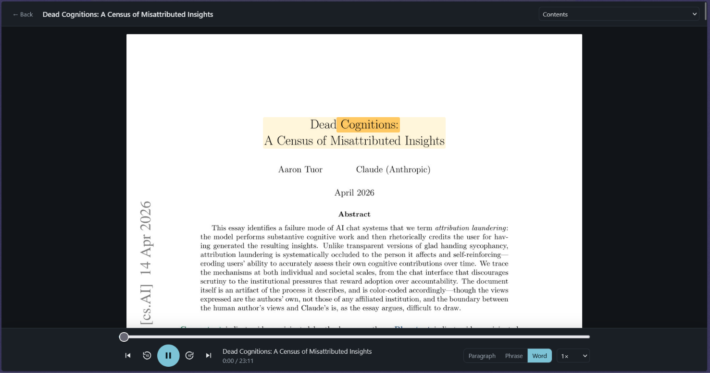
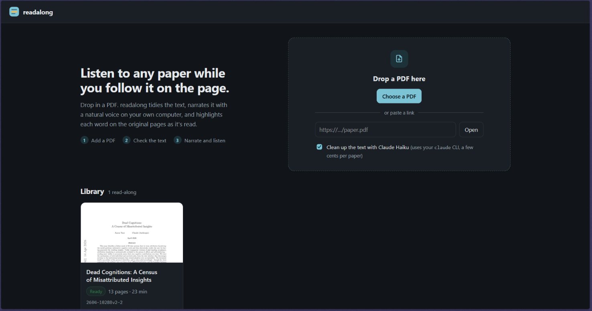
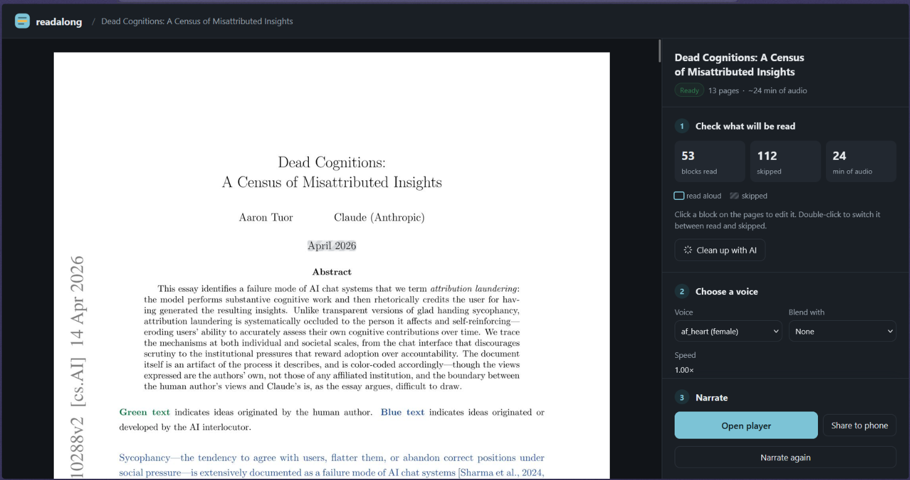
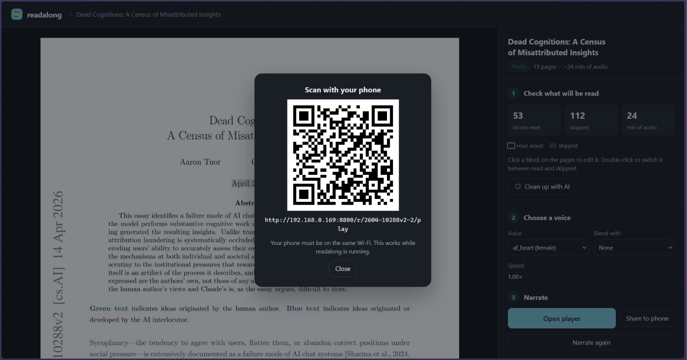
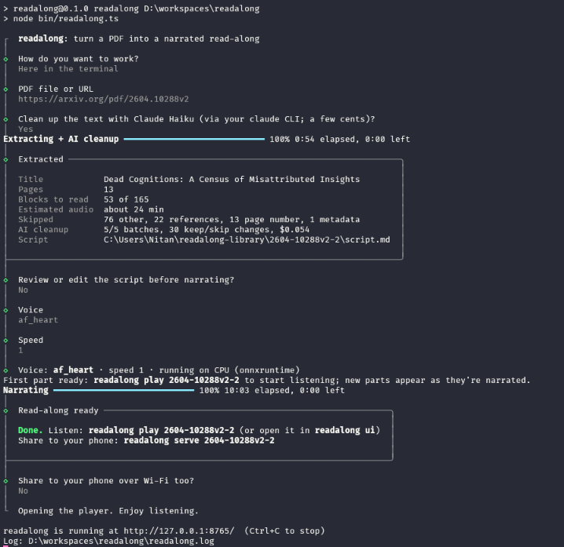

# readalong

Turn any PDF into a **narrated read-along**: natural-sounding audio, played over the PDF's own pages,
with the current paragraph, phrase or word highlighted as it's read. Click anywhere on a page to
read from there. Runs locally on a normal laptop. Node.js only: no Python needed.

Everything is TypeScript: a React + Vite app, and a Node side (CLI, Hono server, background workers)
that Node runs directly, with no build step. The code is organised by feature, with each feature's
server code and UI side by side.

https://github.com/user-attachments/assets/671b4358-d5b2-4785-9629-b45b2f60398a

## Screenshots

The player: the current word is highlighted on the PDF page as it is read.



The library: add a PDF, or play a read-along that you made before.



The review page: check which blocks are read aloud, choose a voice, and narrate.



Share to phone: scan the QR code on the same Wi-Fi to open the player on your phone.



The guided terminal workflow, from a PDF link to a finished read-along.



## Setup

You need [Node.js](https://nodejs.org) 22.18 or newer (it runs TypeScript directly) and [pnpm](https://pnpm.io/installation)
(`corepack enable` gives you the right version). For the optional AI cleanup, install
[Claude Code](https://docs.claude.com/en/docs/claude-code) and sign in (`claude` on your PATH).

```
git clone https://github.com/nitan-jana/readalong.git
cd readalong
pnpm install            # also builds the app
pnpm readalong doctor   # optional: checks the voice engine step by step
```

The voice model (Kokoro-82M, about 340 MB) downloads on first use to `~/.cache/readalong`.
To get a `readalong` command you can run from any folder: `pnpm link --global`.

## Workflow

### In the browser app

```
pnpm start               # same as: pnpm readalong ui  → opens http://127.0.0.1:8765
```

1. **Add a PDF.** Drop it in, choose it, or paste a link. Leave *Clean up with Claude Haiku* ticked.
2. **Review.** Striped blocks are skipped. Click a block to edit how it's spoken; double-click it to
   switch it between read and skipped.
3. **Voice.** Pick a voice (or blend two) and a speed, then **▶ Preview**.
4. **Narrate.** You can cancel, close the tab or reload; the run continues and the page reattaches
   to it. The first part (about 3 minutes) is playable almost right away; the rest appears as it's
   narrated.
5. **Listen.** Click **Open player** (or **Play** in the library). Click on a page to read from there;
   switch between paragraph, phrase and word highlighting. While narration is still running, the
   player shows its progress at the top and picks up each new part as it's ready.
6. **Phone.** **Share to phone** and scan the QR code on the same Wi-Fi. The phone gets the same
   player, read-only, for just that read-along.

### In the terminal

```
pnpm readalong                                     # guided, step by step
pnpm readalong make paper.pdf --ai                 # one shot
pnpm readalong extract paper.pdf --ai              # stop here to edit script.md…
pnpm readalong speak <name>                        # …then narrate it
pnpm readalong play <name>                         # open its player in the app
pnpm readalong voices --samples voices --lang a,b  # one sample clip per voice
pnpm readalong serve <name>                        # QR code for your phone
pnpm readalong doctor                              # diagnose the voice engine
pnpm readalong list                                # what's in your library
pnpm readalong delete <name>                       # remove a read-along
pnpm readalong clean [project]                     # delete cached sentence audio from previous runs
pnpm readalong --help                              # all options
```

`<name>` is the read-along's name in the library (see `pnpm readalong list`). Read-alongs live in
`~/readalong-library/<name>/`: the PDF, the editable `script.md`, page images, the audio and
`narration.json` (timings and highlight boxes). Errors and crash details go to `readalong.log` in the
folder you ran the command from.

**Updating:** `git pull && pnpm install` (rebuilds the app). Narrated sentences are cached per project, so re-narrating
after edits only synthesizes what changed.

## How it works

1. **Extract.** pdf.js reads the text and its positions, groups it into blocks, puts two-column
   layouts in reading order, and skips running headers and footers, page numbers, publisher
   boilerplate, footnotes and figure text, the reference list and back matter. Citation markers are
   dropped from the speech, and abbreviations like "e.g." and "et al." are expanded.
2. **Clean up with AI (optional, `--ai`).** Sends the blocks to **Claude Haiku through your local
   `claude` CLI**. Haiku double-checks keep/skip and rewrites text for listening (symbols, math,
   abbreviations). It's told never to summarise, and a guard rejects anything that shrinks a
   paragraph. A typical paper costs a few cents. If a batch fails, the rule-based result is kept.
3. **Review (optional).** Everything lands in `script.md`, or in the app, where you click blocks on
   the PDF.
4. **Narrate.** One sentence at a time with Kokoro (onnxruntime on the CPU, espeak-ng as WebAssembly
   for pronunciation), cached as MP3. Sentence timing is exact; word timing within a sentence is
   estimated from phoneme counts. Spoken words are aligned back to the word boxes on the PDF, so the
   highlight follows the printed text even where the spoken text differs. Heavy work runs in a
   separate process, so the app stays responsive, cancelling is instant, and a crash is reported
   instead of taking the app down.
5. **Player.** A screen in the app: the page images with paragraph, phrase or word highlighting,
   speed control, keyboard shortcuts, lock-screen controls on phones, and it remembers where you
   stopped.

## Voices

Narration uses **Kokoro-82M**, running locally, with its 28 English voices: American (`af_heart`,
`af_bella`, `am_michael`…) and British (`bf_emma`, `bm_george`…). Blend voices with weights:
`--voice "af_heart:0.6,bf_emma:0.4"`. Compare them with `pnpm readalong voices --samples voices`.

Kokoro's other languages (Spanish, French, Hindi, Italian, Japanese, Portuguese, Mandarin) aren't
available here yet: the JavaScript build of espeak-ng used for pronunciation only includes English.

## Layout

```
index.html, public/        the app's page (Vite)
bin/readalong.ts           command entry point
src/
  app/                     browser shell: entry, routing, API calls, styles
  server/                  Hono app wiring (each feature adds its routes), file serving, ports
  cli/                     commands, the guided wizard, terminal output
  shared/                  types used by both sides; ui/ (page view, progress, icons, dialog); node/ (paths, logging)
  features/
    library/    server/ + ui/   the library folder, adding a PDF, deleting, library page
    pdf/        server/         pdf.js text and page images, what gets read and in what order, script.md
    cleanup/    server/ + ui/   the optional Claude Haiku pass
    review/     server/ + ui/   the read-along page and block editing
    voice/      server/ + ui/   Kokoro model, sentence synthesis, MP3, voice picker
    narration/  server/ + ui/   tracks, word alignment, progress.json, the Narrate step
    player/     server/ + ui/   the player screen and its timing lookups
    jobs/       server/ + ui/   background workers, job progress and cancel, doctor
    sharing/    server/ + ui/   the read-only phone server and QR code
```

Tests sit next to the code they test (`*.test.ts`).

### Working on the app

```
pnpm start        # terminal 1: the API on :8765
pnpm dev          # terminal 2: the app with hot reload on http://localhost:5173
pnpm typecheck    # TypeScript check of both halves
pnpm build        # rebuild dist/app, which `pnpm start` serves
pnpm test         # unit tests
```

## Privacy

- Everything runs on your computer. Your PDFs, the library and the audio stay in `~/readalong-library`.
- Only three things go out, each when you ask for it: the voice model downloads once from GitHub,
  a PDF link you paste is fetched, and *Clean up with AI* sends the PDF's text to Anthropic
  through your own `claude` CLI.
- The app answers only on 127.0.0.1. It refuses requests that use another site's hostname (DNS
  rebinding), and it refuses changes coming from other sites.
- *Share to phone* / `serve` opens a read-only server on your Wi-Fi with only the player for the
  read-alongs you shared. It stays up until readalong stops.
- `readalong.log` (in the folder you start it from) lists file names and links you used. It's in
  `.gitignore`.

## Notes

- Scanned PDFs (images only) have no text to extract; run OCR first (e.g. `ocrmypdf`).
- *Share to phone* / `serve` listens on your local network while it runs; your OS may ask
  whether to allow incoming connections.
- `READALONG_CLAUDE=/path/to/claude` picks a specific Claude Code binary;
  `READALONG_CACHE` moves the model cache; `READALONG_LIBRARY` moves the library.
